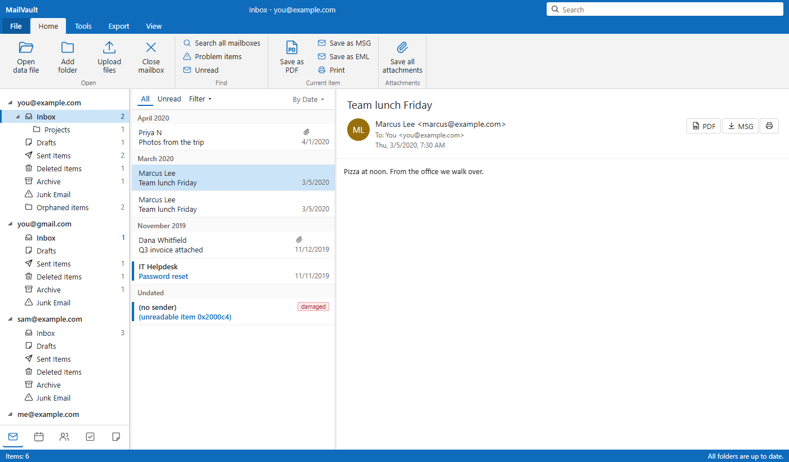

# MailVault

> **Built with the help of AI.** MailVault was designed and written with an AI assistant. The author tested it on real mail archives before releasing it.



A viewer, converter and recovery tool for **PST, OST, MSG, EML, EMLX and MBOX** files, with an Outlook classic-style interface: ribbon, folder pane, message list and reading pane. Your mail is laid out like a mail program, one entry per email account with **Inbox, Drafts, Sent Items, Deleted Items, Archive, Junk Email** and your own folders, even when it comes from thousands of loose .msg files.

The same engine and interface ship three ways:

| Version | What it is | Get it |
|---|---|---|
| Windows app | Opens and reads mail files on your PC, no server needed | `MailVault-Setup.exe` from the [releases](../../releases) |
| Nextcloud app | Scans the Nextcloud folders you map and sorts the mail into your accounts; opens mail files straight from Files | `mailvault-nextcloud.tar.gz` from the releases, plus the Docker engine |
| Docker web UI | Runs on your server, opened in a browser | `docker compose up -d` |

See all screenshots in [docs/SCREENSHOTS.md](docs/SCREENSHOTS.md).

## Your mail, sorted like a mail program

MailVault reads every mail file in your folders and builds one mailbox from them:

- **One entry per account.** Your addresses are found from your Sent folders, from folders named after an address (for example `me@example.com/Sent`), from whole mailbox files, and from any addresses you list in the settings.
- **The usual folders.** Inbox, Drafts, Sent Items, Deleted Items, Archive and Junk Email. A message goes where its folder says, corrected by what the message itself says: drafts and unsent mail go to Drafts, server spam verdicts to Junk Email, mail you sent to Sent Items.
- **Your own folders keep their names**, nested under the account or under the mailbox they were in.
- **Calendar, Contacts, Tasks and Notes** for each account sit behind the buttons at the bottom of the folder pane. Meeting invitations in your mail show up in the calendar on their dates.
- **More views** (folded away): all mail together, mail with attachments, by date, by person, and by source file.
- **New mail is picked up on its own.** Mapped folders are checked every five minutes; an open window refreshes within a minute.

## Features

- **Formats in:** PST and OST (ANSI, Unicode, 4K-page OST 2013+), MSG (including embedded messages), EML, EMLX, MBOX (mboxo/mboxrd), Gmail Takeout.
- **Archives:** ZIP, TAR, TAR.GZ/BZ2/XZ, GZ, 7Z (`py7zr`) and RAR (`rarfile` + `bsdtar`/`unrar`), nested up to 4 levels deep.
- **Export to:** PDF (one per message or one combined PDF), EML, MSG, PST (Unicode and Outlook 97–2002 ANSI), MBOX, HTML, TXT, ICS, VCF, CSV index, JSON, or attachments only. Scope can be the selected items, a folder, a folder and its subfolders, or the whole mailbox; folder structure is kept in the exported ZIP.
- **Convert any format to any other**, for example PST → MBOX/EML/MSG or MBOX → PST.
- **Calendar, People, Tasks and Notes** views with Outlook recurrence (daily, weekly, monthly, "nth weekday", yearly; deleted and changed occurrences; time zones) and non-Gregorian calendars (Hijri, Hebrew, Indian national, Chinese/Korean/Japanese lunisolar).
- **Meeting invitations** inside mail (.ics parts) show as an invite card with time, place, organizer and attendees, and can be opened in the calendar.
- **Saved state for every item:** Sent, Received, Draft, Unsent, Read/Unread, Replied, Forwarded, Flagged, Completed, Deleted, Archived, Junk and categories, from Outlook flags, Gmail labels, Thunderbird/mbox status headers and Apple Mail flags.
- **Fast:** big PSTs are memory-mapped and messages load on demand. A per-file full-text index (subject, people, body, attachment names) builds in the background and is reused. Search accepts `from:`, `to:`, `subject:`, `body:` and `attachment:`.
- **Recovery:**
  - Checks the CRC of every PST block; damaged items are still shown with everything that could be read.
  - **Orphaned items** (their folder is missing or no longer lists them) and **recovered items** (deleted messages still in the file).
  - **Deep scan** rebuilds whole messages, with attachments and recipients, from unreferenced space.
  - Folders are rebuilt from node parent links, so a broken hierarchy table doesn't hide mail.
  - MSG files with a broken FAT keep their partial streams; MBOX data before the first `From ` line is kept and flagged.
  - A **recovery report** (PDF) lists file details, health counts and every problem item.
- **Tools:** health report, message headers, raw MAPI properties, view source, find duplicates, search across everything, remote-image blocking, attachment preview (images, PDF, text, attached mail; Office files with LibreOffice), and opening attached .msg/.eml/.zip files as mailboxes.

## Windows app

Install `MailVault-Setup.exe` from the releases. It installs for your user only (no admin rights) and can register MailVault for .pst, .ost, .msg, .eml, .emlx and .mbox files.

- **Open data file** adds a PST, OST, MBOX or archive to your mail, sorted into your accounts. Opened files are remembered; right-click one under **More views → Files** to remove it again (the file itself is never touched).
- **Add folder** puts a folder in the **Library**. Every mail file inside it, including subfolders, is sorted into your accounts, and the folder is checked for new mail every five minutes.
- A single .msg or .eml opened on its own (for example by double-clicking it) is just shown for reading.

Nothing leaves your PC: the app runs the engine on a private localhost port that only its own window can use. PDF export uses Edge or Chrome if installed, otherwise a plain-text PDF.

To run from source: `pip install -r requirements-desktop.txt && python -m mailvault desktop [file.pst]`. macOS and Linux builds come from the same workflow.

## Nextcloud app

The Nextcloud app is a front end; the mail is read by the MailVault engine, a Docker container next to Nextcloud.

1. Run the engine with `MAILVAULT_TOKEN` (and `MAILVAULT_PASSWORD`) set, on a Docker network Nextcloud can reach, for example `http://mailvault:8080`. It doesn't need to be public. [deploy/stack.example.yml](deploy/stack.example.yml) is a starting point.
2. Install the app from the release (or build it with `sh nextcloud/build.sh`):
   ```bash
   tar -xzf mailvault-nextcloud.tar.gz -C /path/to/nextcloud/custom_apps
   occ app:enable mailvault
   ```
3. In **Administration settings → Additional settings → MailVault**, enter the engine URL and token and click **Save and test**.

Then:

- **Every user maps their own folders** in **Personal settings → MailVault**: any folder they can open in Files (their own, shared with them, group folders, external storage). The mail inside is imported and sorted into their accounts, and the folders are rescanned every five minutes by Nextcloud's background jobs (cron).
- **Admins can map a folder for others** (everyone, admins, or chosen users and groups).
- **Clicking a mail file in Files** opens it in MailVault, like opening a document in an office app.
- **List your email addresses** in the personal settings if MailVault should treat more addresses as yours (old jobs, old providers).
- Users only ever see mail from folders they can open; the engine enforces this on every request.
- **Reading files in place** (optional): mount Nextcloud's data directory and external storage into the engine read-only and set the path map in the admin settings (for example `/var/www/html/data=/ncdata`). Otherwise files are streamed to the engine through Nextcloud.

Needs Nextcloud 29–35.

### Option B: deploy through Nextcloud AppAPI (ExApp)

Nextcloud pulls and runs the MailVault container itself; there's no engine URL or token to set.

1. Set up AppAPI with a deploy daemon (Administration settings → AppAPI).
2. Build the engine image (`docker build -t <registry>/mailvault .`), push it to a registry your deploy daemon can reach, and set `<image>` in `nextcloud/exapp/appinfo/info.xml` to match.
3. Register it:
   ```bash
   occ app_api:app:register mailvault <daemon> --info-xml /path/to/nextcloud/exapp/appinfo/info.xml
   ```

## Docker web UI

```bash
docker compose up -d        # edit the volume paths and passwords in docker-compose.yml first
```
Open `http://server:8080`. Files under the mounted folders appear in **Open data file**; you can also drag and drop or upload files.

| Variable | Purpose |
|---|---|
| `MAILVAULT_PASSWORD` | Browser login (basic auth, any username) |
| `MAILVAULT_TOKEN` | Shared secret for the Nextcloud app |
| `MAILVAULT_MAX_UPLOAD_MB` | Upload limit (default 20480) |
| `MAILVAULT_LIBRARY_ALLOW` | Path prefixes that library folders may use, `:`-separated (default: anywhere) |
| `MAILVAULT_LIBRARY_EDIT` | Set to `0` to stop the web UI from adding or removing library folders |
| `MAILVAULT_INDEX_THREADS` | Search indexes built at the same time (default 2) |

## Command line

```bash
python -m mailvault info archive.pst
python -m mailvault convert archive.pst --to mbox --out archive.zip
python -m mailvault convert broken.pst --to eml --out rescued.zip --only orphaned,recovered,damaged
python -m mailvault serve --data /mail --port 8080
```

## Building

- **Windows installer:** `pip install -r requirements-desktop.txt`, then `pyinstaller --noconfirm packaging/mailvault.spec` and `iscc packaging\installer.iss` (Inno Setup 6).
- **Nextcloud app:** `cd nextcloud/mailvault && npm install && npm run build`, then `sh nextcloud/build.sh`.
- **Engine image:** `docker build -t mailvault .`
- Pushing a `v*` tag runs `.github/workflows/build.yml`, which tests everything and builds the Windows, macOS and Linux apps and the Nextcloud app. The engine image is built by hand.

The version number lives in `mailvault/__init__.py`, `pyproject.toml`, `packaging/installer.iss` and the two `appinfo/info.xml` files.

## Tests

```bash
pip install -r requirements.txt httpx2   # httpx2 is only needed by the tests
python tests/make_fixtures.py   # sample PST (with damaged, orphaned, deleted, calendar, contact, task and note items), MSG/EML/MBOX/Gmail/ZIP and invites
python tests/test_core.py
python tests/test_server.py     # starts the real server and checks the API end to end
python tests/test_library.py
python tests/test_invites.py
python tests/test_collection.py # importing, sorting into accounts and folders, search, isolation between users
python tests/test_desktop_mail.py
```

## Known limits

- PST output (Unicode and ANSI) was checked with MailVault's own reader and a strict structural validator: CRCs, signatures, B-tree ordering, allocation maps and table consistency. Outlook itself wasn't available to test against, so run **SCANPST.EXE** on your first exports.
- Deep scan pairs a rebuilt message with its attachments and recipients by block position, because the index entry that joined them is gone. Each item found this way says so.
- **Umm al-Qura** is an observation-based calendar published as a table. MailVault expands it with the tabular Hijri rules, so an occurrence can land a day off.
- ANSI PSTs are limited by the format itself: 2 GB, 65,535 items per folder, and one code page per message.
- Which account a message belongs to is worked out from the mail itself; list your addresses in the settings if a mailbox lands under the wrong one.

## License

[MIT](LICENSE)
